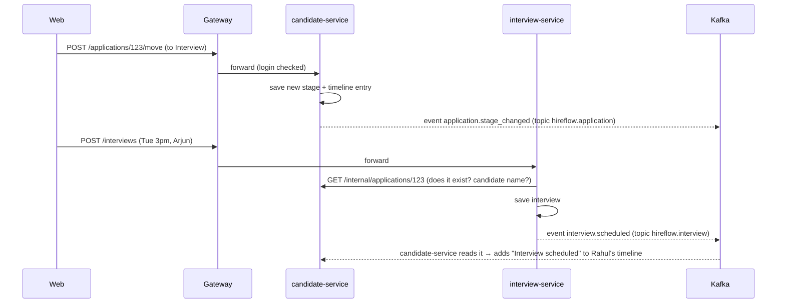

# 01 · Product Overview: How HireFlow Works

## 1. What it is (and is not)
HireFlow is an **internal tool for a company's hiring team**. Candidates find jobs elsewhere (LinkedIn, Naukri, referrals, career fairs). HR then **adds them into HireFlow**, and the team manages everything from there: triage, interviews, feedback, decisions. Candidates **never log in**. At most, they receive emails.

```
 OUTSIDE (job portals, referrals, CVs by email)        INSIDE THE COMPANY: HireFlow
 ─────────────────────────────────────────────  ──▶  Inbox → Screen → Interview → Offer → Hired
                      HR adds candidate (form / CSV)
```

## 2. One-paragraph pitch
An **HR** user creates a **job**. Candidates are added and **attached** to the job. That link is called an **application**, and it shows as a **card** on a **Kanban board**. The card moves through **stages**: Applied → Screen → Interview → Offer → Hired. HR schedules **interviews**, and **interviewers** submit **scorecards**. Every action is recorded on the candidate's **timeline**. *(Later phases add offers with approvals, reports, email, and search.)*

## 3. Picture it as a factory line

```
 ┌────────┐   ┌─────────┐   ┌──────────┐   ┌───────┐   ┌───────┐
 │Applied │──▶│ Screen  │──▶│Interview │──▶│ Offer │──▶│ Hired │
 └────────┘   └─────────┘   └──────────┘   └───────┘   └───────┘
      │            │              │             │
      └────────────┴──────────────┴─────────────┴──▶ Rejected
```
| Stage | What happens |
|---|---|
| **Applied** | Just added. Waits in the **Review Inbox** for a quick yes/no on the resume. |
| **Screen** | HR has a 15–30 min call: interest, notice period, salary expectations, communication. |
| **Interview** | Real interviews with employees; each interviewer submits a scorecard. |
| **Offer** | The company decides to hire and makes an offer *(offer module in a later phase)*. |
| **Hired** | Offer accepted. |

Moving a card records **when** it moved, so the board can show **conversion %** (how many moved on) and **average days** spent in each stage.

## 4. The three users
| Role | Who | In one sentence |
|---|---|---|
| **ADMIN** | Head of HR / IT | Sets things up, sees everything, can do everything HR does. |
| **HR** | Recruiters | Runs hiring day to day: jobs, candidates, pipeline, scheduling. |
| **INTERVIEWER** | Employees on panels | Sees their interviews and submits scorecards. |

## 5. A day in the life (the 5-hour demo story)
> 1. **Priya (HR)** logs in, opens **Jobs → New job**, and fills the 3-step wizard. "Backend Engineer" now appears under *Engineering*.
> 2. She clicks **Add candidate**, enters Rahul's details, and attaches him to Backend Engineer. HireFlow calculates a **signal score** (e.g. 82/100) from his skills.
> 3. In the **Review Inbox** she presses **A** (advance), and Rahul moves to *Screen*.
> 4. After the screening call she drags Rahul's card to **Interview** on the **pipeline board**.
> 5. She clicks **Schedule interview** and picks Tuesday 3 pm with **Arjun**.
> 6. **Arjun (Interviewer)** logs in, sees the interview under **My interviews**, and submits a **scorecard**: "Strong Yes".
> 7. Priya opens Rahul's **profile**. The timeline shows every step, including Arjun's scorecard.
>
> *Later phases:* Priya builds an **offer**, it is approved by Neha (HR) → Karan (Admin), the letter is sent, and Rahul moves to **Hired**. Karan checks **Reports**.

## 6. How the services cooperate (behind the scenes)


**Rule of thumb:** a service **asks** another (REST) when it needs an answer right now, and **announces** (Kafka event) when something happened that others may care about.

## 7. Glossary
| Term | Meaning |
|---|---|
| **ATS** | Applicant Tracking System: the hiring team's internal tool |
| **Job** | An open position, grouped by department |
| **Stage** | One column of a job's pipeline |
| **Candidate** | A person (unique by email) |
| **Application** | Candidate × Job: **the card on the board** |
| **Timeline / Activity** | The history of everything that happened to a candidate |
| **Signal score** | A 0–100 rule-based fit score (skills, experience, location) |
| **Scorecard** | An interviewer's ratings + recommendation |
| **Microservice** | A small app owning one business area and its own database |
| **API gateway** | The single front door; the browser only talks to it |
| **Kafka** | The message system services use to announce events to each other |
| **Topic** | A named stream of events in Kafka, e.g. `hireflow.application` |
| **Consumer group** | A service reading a topic; each service gets its own copy of every event |
