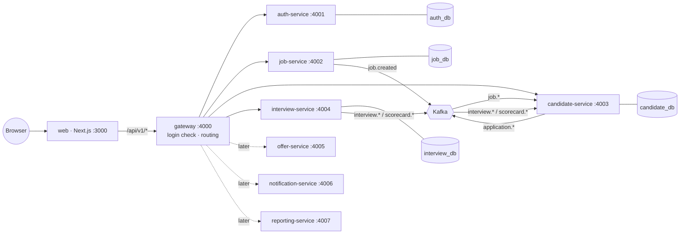

# 03 · Tech Stack & Microservice Architecture

## 1. Big picture


Solid = built in the 5 hours. Dotted = later phases (same template, nothing to redesign).

## 2. Who owns what

| Service | Owns (only it writes this data) | Publishes (topic) | Listens to |
|---|---|---|---|
| **gateway** | nothing | — | — |
| **auth-service** | users, roles, passwords | — *(later: `hireflow.user`)* | — |
| **job-service** | departments, jobs, stages | `job.created`, `job.updated` → `hireflow.job` | — |
| **candidate-service** | candidates, applications, stage history, timeline, notes, review inbox | `application.*` → `hireflow.application` | `hireflow.job`, `hireflow.interview` |
| **interview-service** | interviews, participants, scorecards | `interview.scheduled`, `scorecard.submitted` → `hireflow.interview` | — |
| *later* offer / notification / reporting | offers · notifications+emails · analytics | `hireflow.offer` · — · — | various |

**Golden rule:** a service **never** reads another service's database. It either **asks** (REST) or keeps a small **copy** updated from events.

## 3. How services talk

### 3.1 Browser → gateway → service
```
Browser ── cookie: access_token ──▶ gateway
  gateway: checks the JWT (401 if missing/invalid), adds x-request-id,
           forwards to the right service with  Authorization: Bearer <jwt>
  service: service-kit checks the JWT again → req.user = { id, role, name }
           requireRole(...) on the route → 403 if role not allowed
```
5-hour version: **HS256** JWT signed with a shared `JWT_SECRET` (simple). Later: RS256 (only auth-service holds the private key).

### 3.2 Service → service (ask)
Only when an answer is needed **right now**:
| Caller | Calls | Why |
|---|---|---|
| interview-service | `candidate-service GET /internal/applications/:id` | check the application exists; get candidate name + job title |
| interview-service | `auth-service GET /internal/users?ids=` | get interviewer names/emails |
| candidate-service | `interview-service GET /internal/interviews/assigned?userId=&candidateId=` | may this interviewer see this profile? |

`/internal/*` routes are **not** exposed by the gateway and require header `x-internal-token`.

### 3.3 Events with Kafka (announce)

#### Kafka in 5 minutes (for beginners)
| Concept | Meaning | In HireFlow |
|---|---|---|
| **Broker** | The Kafka server | 1 container |
| **Topic** | A named, append-only list of messages (like a log file) | `hireflow.job`, `hireflow.application`, `hireflow.interview` |
| **Message** | One event: a **key** + a **value** (our JSON envelope) | key = `applicationId`, value = `{ type: "application.stage_changed", … }` |
| **Partition** | A topic is split into partitions for parallelism. **Same key → same partition → kept in order.** | 3 partitions per topic |
| **Producer** | Writes messages | job-, candidate-, interview-service |
| **Consumer group** | A named reader. **Each group gets every message once.** Two different services = two groups = both get everything. | group `candidate-service` |
| **Offset** | A bookmark: "I've read up to message #57". Kafka **keeps** messages, so a group can rewind and **replay**. | reporting-service (later) can rebuild from history |

**Kafka vs a classic queue (RabbitMQ):** a queue deletes a message once it is read; Kafka **keeps** it, so many services can read it independently and it can be replayed. That's why Kafka suits microservices that each build their own view of the data.

#### Our setup
- **Topics:** one per business area: `hireflow.job`, `hireflow.application`, `hireflow.interview` (later `hireflow.user`, `hireflow.offer`, `hireflow.email`).
- **Key:** the entity id (jobId, applicationId, interviewId), so events about the same thing stay in order.
- **Consumer group = service name.**
- **Envelope** (the message value, defined in `packages/contracts`):
```json
{
  "id": "6f1c…",                       // unique event id (for de-duplication)
  "type": "application.stage_changed",
  "occurredAt": "2026-11-03T10:15:00Z",
  "producer": "candidate-service",
  "actor": { "id": "usr_priya", "name": "Priya" },
  "data": { "applicationId": "app_1", "candidateId": "c_1", "jobId": "job_1",
            "fromStage": { "id": "s1", "name": "Screen" }, "toStage": { "id": "s2", "name": "Interview" } }
}
```

### 3.4 Reliability: 5-hour version vs later
| Concern | 5-hour version | Later (Phase B) |
|---|---|---|
| Publishing | Publish **right after** the DB transaction commits | **Transactional outbox**: save the event in the same transaction, a loop publishes it (nothing lost on crash) |
| Duplicates (Kafka may deliver twice) | **Idempotent consumer**: store `event.id` in `ProcessedEvent`; skip if seen | same |
| Consumer errors | Log + retry 3× | + `<topic>.dlq` dead-letter topic |
| Tracing | `x-request-id` in logs | OpenTelemetry |

## 4. Data copies (read models)
| Service | Keeps a copy of | Updated by |
|---|---|---|
| candidate-service | `JobRef` (job title, department, stages, skills) | `job.created/updated` |
| interview-service | candidate name + job title on each Interview (snapshot) | written at creation time |

Copies may be a second behind ("eventual consistency"). That's normal and fine here.

## 5. Tech stack
| Layer | Tool | Why |
|---|---|---|
| Language | **TypeScript** | One language everywhere |
| Monorepo | **pnpm workspaces + Turborepo** | One install; `pnpm dev` starts everything |
| Frontend | **Next.js 14**, Tailwind, **shadcn/ui**, TanStack Query, React Hook Form + Zod, **dnd-kit** | Fast, polished UI |
| Gateway | Express + `http-proxy-middleware` + `jsonwebtoken` | Small and clear |
| Services | **Express + Zod + Prisma**, all from one template | Identical structure |
| Database | **PostgreSQL 16**, one DB per service (one container) | Isolation, light setup |
| Messaging | **Kafka** (KRaft, 1 broker) + **kafkajs** + **kafka-ui** | Requested; kafka-ui shows events live in the demo |
| Logging | pino | JSON logs with request id |
| Tests | Vitest + Supertest; Playwright (smoke) | — |
| Dev infra | Docker Compose | One command |
| Deploy infra (later) | **kind** + Helm + Strimzi + Terraform | See 10 §3 |

## 6. Repository layout
```
hireflow/
├─ apps/web/                      # Next.js
├─ services/
│  ├─ _template/                  # copy to make a new service
│  ├─ gateway/
│  ├─ auth-service/   job-service/   candidate-service/   interview-service/
│  └─ (later) offer-service/ notification-service/ reporting-service/
├─ packages/
│  ├─ contracts/                  # Zod schemas: request bodies + event types (shared)
│  └─ service-kit/                # createService, auth, errors, validate, kafka helpers
├─ infra/docker/postgres-init.sql
├─ docker-compose.yml   turbo.json   pnpm-workspace.yaml   .env.example
├─ CLAUDE.md   README.md
└─ plans/                         # these docs
```

### Inside every service
```
services/candidate-service/
├─ src/
│  ├─ index.ts        # createService({ name, port, routes, consumers })
│  ├─ routes/         # public routes
│  ├─ internal/       # /internal/* routes for other services
│  ├─ services/       # business logic (+ publish events)
│  ├─ consumers/      # Kafka event handlers
│  └─ lib/            # e.g. signalScore.ts
├─ prisma/schema.prisma  prisma/seed.ts
└─ package.json
```
**Layers:** route → service function → Prisma. Keep business logic out of routes.

### What `service-kit` gives every service (built once, in block 1)
| Helper | Does |
|---|---|
| `createService()` | Express app + JSON + pino logger + request id + `/health` + error handler + start Kafka consumers |
| `requireAuth`, `requireRole(...)` | JWT check + RBAC |
| `validate(schema)` | Zod body/query validation → 422 |
| `AppError`, error handler | `{ error: { code, message, details } }` |
| `internal.get(url)` | Service-to-service call with `x-internal-token` |
| `publish(topic, key, event)` | Kafka producer |
| `subscribe(topic, group, handler)` | Kafka consumer + `ProcessedEvent` de-duplication |

## 7. Business logic notes
**Signal score** (candidate-service): required skills matched 50 · nice-to-have 15 · experience vs minimum 20 · location/remote 10 · source (referral 5) 5. Stored with a breakdown.

**Column metrics** (candidate-service, from `StageTransition`):
- count = active cards in the column
- conversion % = moved forward out of the stage ÷ entered the stage
- avg days = average time between entering and leaving

## 8. Trade-offs (say this to the judges)
| Benefit | Cost | How we handle it |
|---|---|---|
| Each service deploys/scales alone | More moving parts | One template, one compose file |
| Clear ownership | No cross-DB joins | Small copies via events |
| Failure isolation | Eventual consistency | Idempotent consumers; outbox later |
| Kafka keeps history | Heavier than a queue | Single KRaft broker locally; kafka-ui for visibility |
