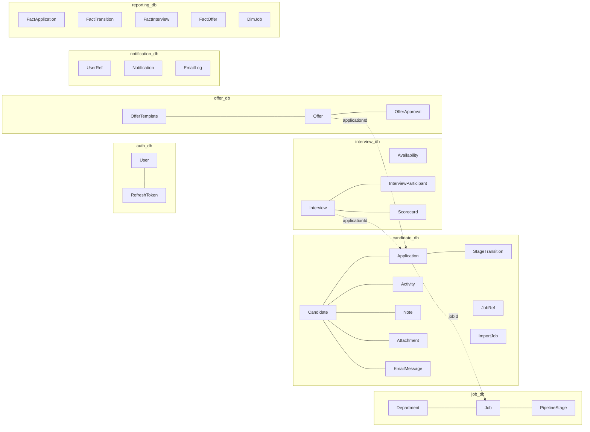

# 04 · Database Models (Database per Service)

Each service has its **own PostgreSQL database** and its **own `prisma/schema.prisma`**. Locally, all databases live in one Postgres container (created by `infra/docker/postgres-init.sql`).

| Database | Service | When |
|---|---|---|
| `auth_db` | auth-service | ✅ 5h |
| `job_db` | job-service | ✅ 5h |
| `candidate_db` | candidate-service | ✅ 5h |
| `interview_db` | interview-service | ✅ 5h |
| `offer_db`, `notification_db`, `reporting_db` | later services | ⏩ Phase A |

Fields marked `// later` can be left out of the 5-hour build.

**Rules**
- A service only reads and writes its own DB.
- IDs from other services are stored as **plain strings** (no foreign key), e.g. `Application.jobId`.
- When a service needs another service's data for display, it keeps a **snapshot** or a **read model** (see 03 §4).
- Prisma: put each enum value on its own line in the real file. They are compressed here to save space.

## 0. Shared tables (from `service-kit`)

```prisma
model ProcessedEvent {         // ✅ 5h: in every service that CONSUMES Kafka events
  eventId     String   @id     // envelope.id; if it already exists → skip (Kafka can redeliver)
  processedAt DateTime @default(now())
}

model OutboxEvent {            // ⏩ Phase B: transactional outbox (not needed in the 5h build)
  id          String    @id            // event id
  topic       String                   // "hireflow.application"
  key         String                   // Kafka message key, e.g. applicationId
  type        String                   // "application.stage_changed"
  payload     Json                     // full envelope
  createdAt   DateTime  @default(now())
  publishedAt DateTime?
  @@index([publishedAt, createdAt])
}
```

## 1. Overview


Dotted lines = references by ID across services (no real foreign key).

---

## 2. auth-service · `auth_db` ✅

```prisma
enum Role { ADMIN HR INTERVIEWER }

model User {
  id            String    @id @default(cuid())
  email         String    @unique
  name          String
  passwordHash  String?                 // null for Google-only users
  googleId      String?   @unique         // later (Google sign-in)
  role          Role      @default(HR)
  isActive      Boolean   @default(true)
  mfaEnabled    Boolean   @default(false) // later (2FA)
  mfaSecretEnc  String?                 // later (2FA) encrypted TOTP secret
  timezone      String    @default("Asia/Kolkata")
  createdAt     DateTime  @default(now())
  updatedAt     DateTime  @updatedAt
  refreshTokens RefreshToken[]           // later (5h: access token only, 8h expiry)
}

model RefreshToken {                      // later
  id        String    @id @default(cuid())
  userId    String
  tokenHash String    @unique
  expiresAt DateTime
  revokedAt DateTime?
  createdAt DateTime  @default(now())
  user      User      @relation(fields: [userId], references: [id], onDelete: Cascade)
  @@index([userId])
}
// (OutboxEvent later)
```

## 3. job-service · `job_db` ✅

```prisma
enum JobStatus      { DRAFT OPEN CLOSED }
enum EmploymentType { FULL_TIME PART_TIME CONTRACT INTERN }
enum StageKind      { APPLIED SCREEN INTERVIEW OFFER HIRED CUSTOM }

model Department {
  id        String   @id @default(cuid())
  name      String   @unique
  createdAt DateTime @default(now())
  jobs      Job[]
}

model Job {
  id               String         @id @default(cuid())
  title            String
  departmentId     String
  ownerId          String                    // HR user responsible (auth user id)
  location         String
  remoteAllowed    Boolean        @default(false)
  employmentType   EmploymentType @default(FULL_TIME)
  description      String                    // markdown
  requiredSkills   String[]
  niceToHaveSkills String[]
  minYears         Int            @default(0)
  salaryMin        Int?
  salaryMax        Int?
  currency         String         @default("INR")
  openings         Int            @default(1)
  status           JobStatus      @default(DRAFT)
  publishedAt      DateTime?
  closedAt         DateTime?
  createdAt        DateTime       @default(now())
  updatedAt        DateTime       @updatedAt
  department       Department     @relation(fields: [departmentId], references: [id])
  stages           PipelineStage[]
  @@index([departmentId, status])
}

model PipelineStage {
  id       String    @id @default(cuid())
  jobId    String
  name     String
  kind     StageKind @default(CUSTOM)
  position Int                               // 0,1,2… column order
  job      Job       @relation(fields: [jobId], references: [id], onDelete: Cascade)
  @@unique([jobId, position])
}
// (OutboxEvent later)
```
Default stages for a new job: Applied(0) · Screen(1) · Interview(2) · Offer(3) · Hired(4).

## 4. candidate-service · `candidate_db` ✅

```prisma
enum ApplicationStatus { ACTIVE REJECTED HIRED }
enum CandidateSource   { MANUAL CSV_IMPORT REFERRAL LINKEDIN OTHER }
enum ImportStatus      { PENDING PROCESSING COMPLETED FAILED }

model JobRef {                              // read model, filled from job.* events
  id         String   @id                   // = job-service Job.id
  title      String
  department String
  status     String
  requiredSkills   String[]
  niceToHaveSkills String[]
  minYears   Int
  location   String
  remoteAllowed Boolean
  stages     Json                           // [{ id, name, kind, position }]
  updatedAt  DateTime @updatedAt
}

model Candidate {
  id              String          @id @default(cuid())
  firstName       String
  lastName        String
  email           String          @unique
  phone           String?
  location        String?
  currentTitle    String?
  currentCompany  String?
  yearsExperience Int?
  skills          String[]
  linkedinUrl     String?
  source          CandidateSource @default(MANUAL)
  tags            String[]
  createdAt       DateTime        @default(now())
  updatedAt       DateTime        @updatedAt
  applications    Application[]
  activities      Activity[]
  notes           Note[]
  attachments     Attachment[]       // later
  emails          EmailMessage[]     // later
}

model Application {
  id              String            @id @default(cuid())
  candidateId     String
  jobId           String                     // job-service id
  currentStageId  String                     // job-service stage id (validated via JobRef)
  status          ApplicationStatus @default(ACTIVE)
  stageEnteredAt  DateTime          @default(now())
  signalScore     Int               @default(0)
  signalBreakdown Json?
  reviewedAt      DateTime?                  // null = shows in Review Inbox
  rejectReason    String?
  hiredAt         DateTime?
  createdAt       DateTime          @default(now())
  updatedAt       DateTime          @updatedAt
  candidate       Candidate         @relation(fields: [candidateId], references: [id], onDelete: Cascade)
  transitions     StageTransition[]
  @@unique([candidateId, jobId])
  @@index([jobId, currentStageId, status])
  @@index([reviewedAt])
}

model StageTransition {
  id            String      @id @default(cuid())
  applicationId String
  fromStageId   String?                       // null when created
  toStageId     String
  movedById     String?
  enteredFromAt DateTime?                     // when it entered fromStage → duration
  movedAt       DateTime    @default(now())
  application   Application @relation(fields: [applicationId], references: [id], onDelete: Cascade)
  @@index([applicationId])
  @@index([toStageId, movedAt])
}

model Activity {                             // the candidate timeline
  id            String    @id @default(cuid())
  candidateId   String
  applicationId String?
  actorId       String?
  actorName     String?
  type          String                       // "STAGE_CHANGED" | "NOTE_ADDED" | "INTERVIEW_SCHEDULED" | "SCORECARD_SUBMITTED" | "OFFER_SENT" …
  summary       String                       // human text: "Priya moved to Interview"
  payload       Json?
  createdAt     DateTime  @default(now())
  candidate     Candidate @relation(fields: [candidateId], references: [id], onDelete: Cascade)
  @@index([candidateId, createdAt])
}

model Note {
  id          String    @id @default(cuid())
  candidateId String
  authorId    String
  authorName  String
  body        String
  createdAt   DateTime  @default(now())
  candidate   Candidate @relation(fields: [candidateId], references: [id], onDelete: Cascade)
}

model Attachment {                           // later (resume upload)
  id          String    @id @default(cuid())
  candidateId String
  fileName    String
  mimeType    String
  sizeBytes   Int
  storageKey  String                         // MinIO/S3 key
  kind        String    @default("RESUME")
  createdAt   DateTime  @default(now())
  candidate   Candidate @relation(fields: [candidateId], references: [id], onDelete: Cascade)
}

model EmailMessage {                         // later; sending = notification-service
  id          String    @id @default(cuid())
  candidateId String
  sentById    String
  subject     String
  bodyHtml    String
  createdAt   DateTime  @default(now())
  candidate   Candidate @relation(fields: [candidateId], references: [id], onDelete: Cascade)
}

model ImportJob {                            // later (CSV import)
  id          String       @id @default(cuid())
  createdById String
  jobId       String?
  fileName    String
  status      ImportStatus @default(PENDING)
  totalRows   Int          @default(0)
  createdRows Int          @default(0)
  skippedRows Int          @default(0)
  errors      Json?                          // [{ row, message }]
  createdAt   DateTime     @default(now())
  finishedAt  DateTime?
}
// + ProcessedEvent (consumers) · OutboxEvent later
```

## 5. interview-service · `interview_db` ✅

```prisma
enum InterviewStatus { SCHEDULED COMPLETED CANCELLED }
enum Recommendation  { STRONG_NO NO YES STRONG_YES }

model Availability {                         // later (visual availability grid)
  id       String @id @default(cuid())
  userId   String
  weekday  Int                                // 0=Sun … 6=Sat
  startMin Int                                // 600 = 10:00
  endMin   Int
  @@index([userId])
}

model Interview {
  id              String          @id @default(cuid())
  applicationId   String
  candidateId     String                       // snapshot
  candidateName   String                       // snapshot
  jobId           String                       // snapshot
  jobTitle        String                       // snapshot
  title           String                       // "Technical round"
  startAt         DateTime
  endAt           DateTime
  location        String?
  status          InterviewStatus @default(SCHEDULED)
  externalEventId String?                      // later: Google Calendar sync
  createdById     String
  createdAt       DateTime        @default(now())
  participants    InterviewParticipant[]
  scorecards      Scorecard[]
  @@index([startAt])
  @@index([applicationId])
}

model InterviewParticipant {
  interviewId String
  userId      String
  userName    String
  userEmail   String
  interview   Interview @relation(fields: [interviewId], references: [id], onDelete: Cascade)
  @@id([interviewId, userId])
  @@index([userId])
}

model Scorecard {
  id            String         @id @default(cuid())
  interviewId   String
  interviewerId String
  interviewerName String
  ratings       Json                           // [{ criterion, score: 1-4, comment }]
  overall       Recommendation
  summary       String
  submittedAt   DateTime       @default(now())
  interview     Interview      @relation(fields: [interviewId], references: [id], onDelete: Cascade)
  @@unique([interviewId, interviewerId])
}
// + ProcessedEvent (consumers) · OutboxEvent later
```

## 6. offer-service · `offer_db` ⏩ Phase A

```prisma
enum OfferStatus    { DRAFT PENDING_APPROVAL APPROVED SENT ACCEPTED DECLINED }
enum ApprovalStatus { WAITING PENDING APPROVED REJECTED }

model OfferTemplate {
  id        String   @id @default(cuid())
  name      String
  bodyHtml  String                             // "Dear {{candidate.firstName}} …"
  createdAt DateTime @default(now())
  offers    Offer[]
}

model Offer {
  id             String       @id @default(cuid())
  applicationId  String       @unique
  candidateId    String                         // snapshots ↓
  candidateName  String
  candidateEmail String
  jobId          String
  jobTitle       String
  templateId     String?
  salary         Int
  currency       String       @default("INR")
  bonus          Int?
  startDate      DateTime
  expiresAt      DateTime?
  status         OfferStatus  @default(DRAFT)
  renderedHtml   String?                        // final letter snapshot at send time
  createdById    String
  submittedAt    DateTime?
  sentAt         DateTime?
  decidedAt      DateTime?
  createdAt      DateTime     @default(now())
  updatedAt      DateTime     @updatedAt
  template       OfferTemplate? @relation(fields: [templateId], references: [id])
  approvals      OfferApproval[]
  @@index([status])
}

model OfferApproval {
  id           String         @id @default(cuid())
  offerId      String
  step         Int                              // 1, 2, 3…
  approverId   String                           // HR or ADMIN user
  approverName String
  status       ApprovalStatus @default(WAITING)
  comment      String?
  decidedAt    DateTime?
  offer        Offer          @relation(fields: [offerId], references: [id], onDelete: Cascade)
  @@unique([offerId, step])
  @@index([approverId, status])
}
// + ProcessedEvent (consumers) · OutboxEvent later
```

## 7. notification-service · `notification_db` ⏩ Phase A

```prisma
model UserRef {                               // read model from user.* events
  id     String @id
  name   String
  email  String
  role   String
  isActive Boolean @default(true)
}

model Notification {
  id        String    @id @default(cuid())
  userId    String
  type      String                            // "INTERVIEW_ASSIGNED" | "OFFER_APPROVAL_NEEDED" | …
  title     String
  body      String?
  link      String?                           // "/candidates/abc"
  readAt    DateTime?
  createdAt DateTime  @default(now())
  @@index([userId, readAt, createdAt])
}

model EmailLog {
  id        String   @id @default(cuid())
  to        String
  subject   String
  template  String
  status    String                            // SENT | FAILED
  error     String?
  sourceEventId String
  createdAt DateTime @default(now())
}
// + ProcessedEvent
```

## 8. reporting-service · `reporting_db` ⏩ Phase A (analytics, filled only from events)

```prisma
model DimJob          { id String @id; title String; department String; status String; openedAt DateTime?; closedAt DateTime? }
model FactApplication { id String @id; jobId String; source String?; status String; createdAt DateTime; hiredAt DateTime? }
model FactTransition  { id String @id; applicationId String; jobId String; fromKind String?; toKind String; movedAt DateTime; daysInFrom Float? }
model FactInterview   { id String @id; jobId String; startAt DateTime; status String }
model FactOffer       { id String @id; jobId String; status String; submittedAt DateTime?; decidedAt DateTime? }
// + ProcessedEvent
```
(Written on one line here for brevity; use normal multi-line Prisma in the real file.)

## 9. Business rules the code must enforce

| Rule | Service | When |
|---|---|---|
| One application per (candidate, job) | candidate (`@@unique`) | ✅ |
| Candidate unique by email | candidate | ✅ |
| A stage move = update Application + insert StageTransition + insert Activity **in one DB transaction**, then publish `application.stage_changed` | candidate | ✅ (outbox in Phase B) |
| Moving to a `HIRED` stage sets `status=HIRED`, `hiredAt` | candidate | ✅ |
| Consumers skip events whose `id` is already in `ProcessedEvent` | all consumers | ✅ |
| No double-booking an interviewer | interview | ✅ (cut if late) |
| Only panel members can submit a scorecard for an interview | interview | ✅ |
| Interviewer sees others' scorecards only after submitting their own | interview | ⏩ |
| `offer.accepted` → candidate-service moves the application to HIRED | candidate | ⏩ |
| Approval chain: step 1 PENDING, the others WAITING; each approve activates the next; last approve → APPROVED; any reject → DRAFT | offer | ⏩ |
| Jobs are closed, not deleted; users are deactivated, not deleted | job, auth | ⏩ |

## 10. Seed data (per service `prisma/seed.ts`)
**5-hour seed (keep it small but realistic):**
- **auth:** Karan `admin@hireflow.dev` (ADMIN), Priya `priya@` (HR), Neha `neha@` (HR), Arjun `arjun@` (INTERVIEWER), Sara `sara@` (INTERVIEWER). Password `Passw0rd!`
- **job:** Engineering, Sales, Design; 3 jobs with default stages
- **candidate:** 30 candidates, ~35 applications spread across stages, with back-dated transitions so the metrics look real; matching `JobRef` rows
- **interview:** 3 interviews, 1 scorecard

**Later:** more volume, offers, reporting data.

Seed scripts use **fixed IDs** (e.g. `usr_priya`, `job_backend`, `stg_backend_screen`) so references across services line up without calling each other.
